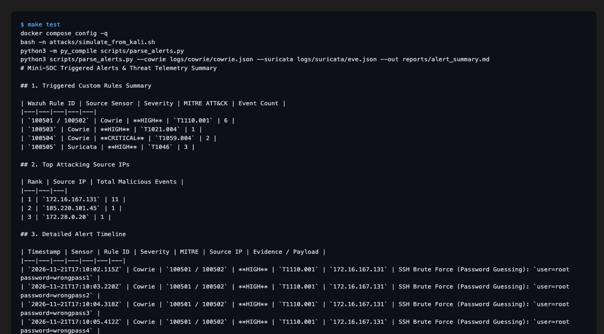

# docker-mini-soc: Production-Style Single-Host Mini-SOC Lab

**Problem:** Security analysts and detection engineers need a lightweight, repeatable single-host SOC environment (<5 GB RAM) combining an SSH/Telnet honeypot (**Cowrie**), a network IDS (**Suricata**), and a SIEM manager/indexer (**Wazuh + OpenSearch**) with custom MITRE ATT&CK detections and automated log triage.

## ASCII Architecture Diagram

```text
+-----------------------------------------------------------------------------------+
| Kali Linux Attacker VM (172.16.167.131)                                           |
|   attacks/simulate_from_kali.sh  --->  nmap (T1046) + hydra (T1110) + ssh (T1059) |
+-----------------------------------------+-----------------------------------------+
                                          |
                                          | TCP :2222 / :2223
                                          v
+-----------------------------------------------------------------------------------+
| Docker Bridge Network: soc_net (172.28.0.0/24)                                    |
|                                                                                   |
|  +------------------------------+       +--------------------------------------+  |
|  | Cowrie Honeypot (2.5.0)      |       | Suricata IDS (7.0.4)                 |  |
|  | IP: 172.28.0.20 (:2222)      |       | IP: 172.28.0.30 (af-packet eth0)     |  |
|  | Logs: logs/cowrie/cowrie.json|       | Logs: logs/suricata/eve.json         |  |
|  +--------------+---------------+       +-------------------+------------------+  |
|                 |                                           |                     |
|                 +---------------------+---------------------+                     |
|                                       | Shared Bind-Mount Volumes (:ro)           |
|                                       v                                           |
|  +-----------------------------------------------------------------------------+  |
|  | Wazuh Manager (4.7.3)  [IP: 172.28.0.11]                                    |  |
|  | Custom Rules: rules/custom_wazuh_rules.xml (Rules 100500 - 100505)          |  |
|  +------------------------------------+----------------------------------------+  |
|                                       |                                           |
|                                       v                                           |
|  +-----------------------------------------------------------------------------+  |
|  | OpenSearch Single-Node Indexer (2.11.1)  [IP: 172.28.0.10, Heap: 512MB]     |  |
|  +-----------------------------------------------------------------------------+  |
+-----------------------------------------------------------------------------------+
                                          |
                                          v
                   scripts/parse_alerts.py -> reports/alert_summary.md
```

## MITRE ATT&CK Custom Detection Mapping (`rules/custom_wazuh_rules.xml`)

| Wazuh Rule ID | Wazuh Level | Sensor Source | MITRE Tactic | MITRE Technique | Detection Logic |
|---|---|---|---|---|---|
| `100501` | `6` | Cowrie JSON | Credential Access | `T1110.001` — Password Guessing | Single `cowrie.login.failed` event |
| `100502` | `10` | Cowrie JSON | Credential Access | `T1110` — Brute Force | `5+` failed logins (`100501`) within `120s` from `same_source_ip` |
| `100503` | `12` | Cowrie JSON | Lateral Movement / Initial Access | `T1021.004` / `T1078` — SSH Valid Accounts | `cowrie.login.success` event on honeypot |
| `100504` | `13` | Cowrie JSON | Execution | `T1059.004` — Unix Shell | `cowrie.command.input` matching `wget\|curl\|chmod +x\|/etc/shadow\|/etc/passwd\|id\|uname -a` |
| `100505` | `10` | Suricata `eve.json` | Discovery | `T1046` — Network Service Discovery | Suricata `event_type=alert` (`ET SCAN Potential SSH Scan`, `LibSSH BruteForce`) |

## Quick Start & Makefile Usage

```bash
# 1. Validate docker-compose.yml, syntax-check scripts, and parse telemetry into Markdown report
make test

# 2. Launch the Mini-SOC stack (<2.5 GB total RAM footprint)
make up

# 3. Run the repeatable attack simulation from Kali Linux
bash attacks/simulate_from_kali.sh 172.16.167.131 2222

# 4. Generate the Markdown alert summary table
python3 scripts/parse_alerts.py --cowrie logs/cowrie/cowrie.json --suricata logs/suricata/eve.json --out reports/alert_summary.md
```

## Dashboard & Alert Screenshots



Generated report: [reports/alert_summary.md](reports/alert_summary.md)
